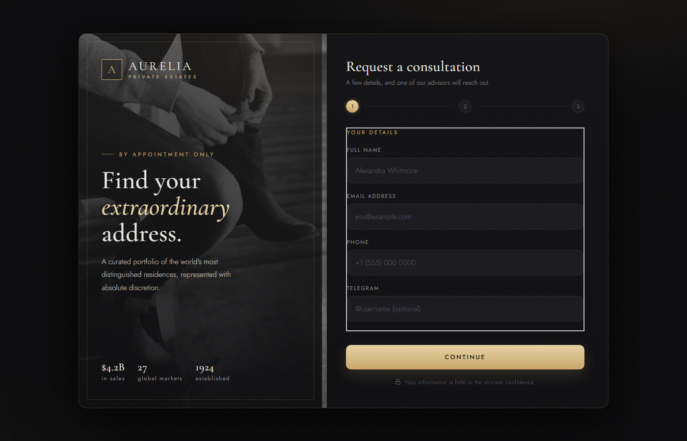
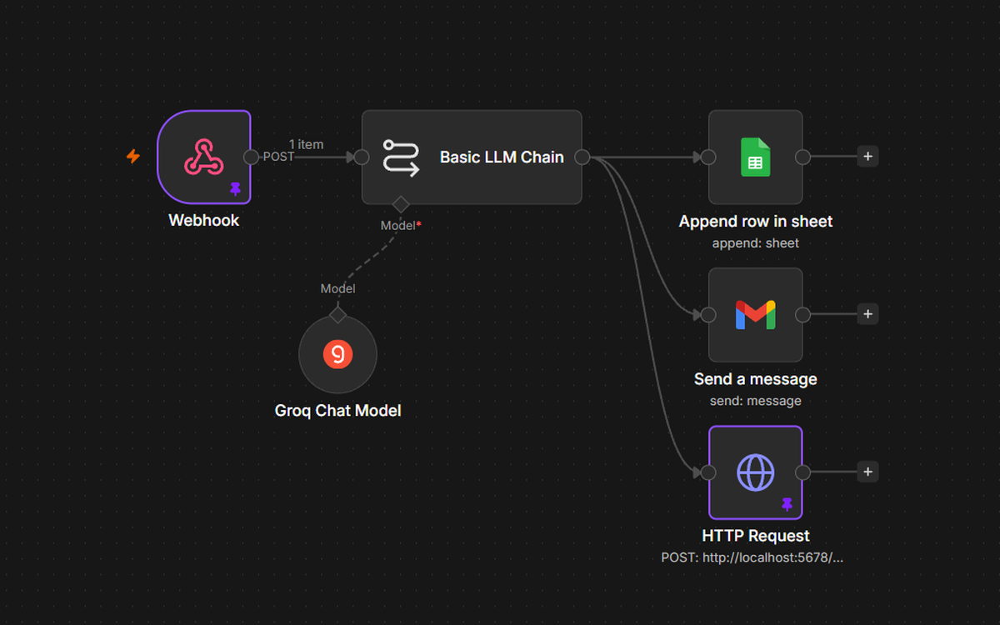
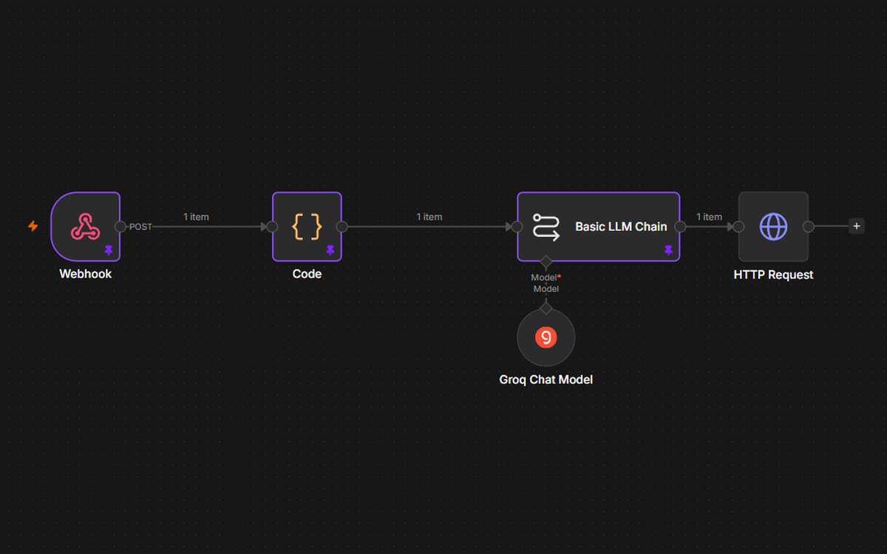
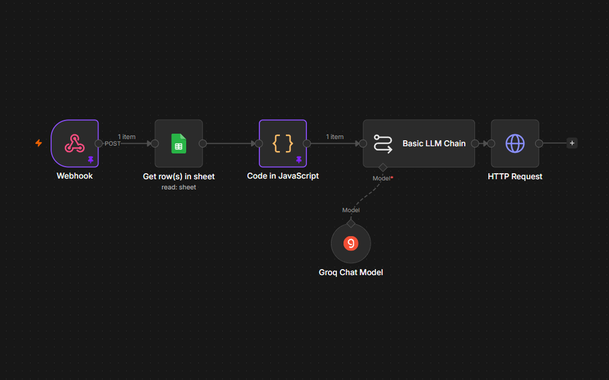
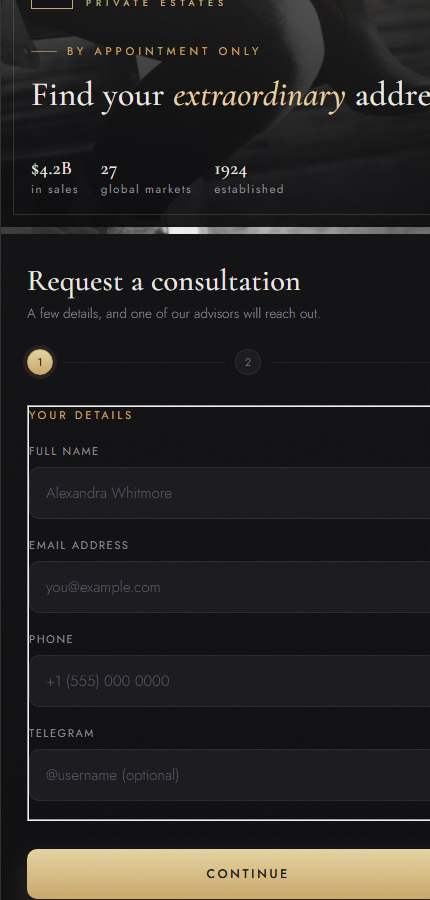

# Sophie – AI lead assistant for real estate (n8n + Telegram)

A personal automation project: when someone fills the inquiry form of a (fictional) real-estate agency,
an AI assistant called **Sophie** contacts them on Telegram, answers their questions and qualifies the lead.
Built with the help of AI tools (Claude Code, ChatGPT) while learning n8n.



## How it works

```
Lead form (HTML)  ──POST /webhook/lead──▶  n8n workflow  ──POST /send──▶  sophie.py  ──▶  Telegram
                                              ▲                                 │
                                              └── POST /webhook/reply ◀── incoming message + last 20 msgs
                                              (Groq LLM writes Sophie's answer, sent back with POST /send)
```

- **lead-form.html** – 3-step inquiry form (contact details, search, specifics) that sends the lead to an n8n webhook.
- **workflows/** – the 3 n8n workflows (receptionist, sales agent, conversation), exported without credentials.
- **n8n workflow** – receives the lead, writes the first message, and for every reply calls an LLM (Groq) with the
  conversation history to generate Sophie's answer.
- **sophie.py** – small bridge between n8n and Telegram: a Flask API (`/send`, `/start-conversation`) and a
  Telethon listener that forwards private replies (with the last 20 messages as context) back to n8n.
  Groups and channels are ignored.

## Screenshots

The 3 n8n workflows, captured from my n8n editor (the local network address under the HTTP Request nodes is blanked out).

**receptionist**



**sales agent**



**Conversation**



**Lead form on mobile**



## Real usage (June 2026)

Numbers from n8n's own execution statistics while I tested Sophie with real leads (1–8 June 2026):

| Workflow | Production runs | Successful | Avg. run time |
|---|---|---|---|
| receptionist (new lead → first message) | 31 | 21 | 5.1 s |
| sales agent | 11 | 7 | 0.9 s |
| Conversation (AI reply on Telegram) | 34 | 34 | 1.6 s |

The failures happened while I was still editing the workflows (12 of the 14 on 6 June, the day I reworked them).

## Run it

```bash
pip install -r requirements.txt
cp .env.example .env      # add your Telegram API_ID / API_HASH from my.telegram.org
python sophie.py          # Flask on :3001, n8n expected on :5678
```

In `lead-form.html`, set `WEBHOOK_URL` to your n8n webhook.

## What I learned

Webhooks and HTTP between services, n8n workflows, prompting an LLM with conversation history,
the Telegram API (Telethon), and keeping secrets out of the code (`.env`, `.gitignore`).
